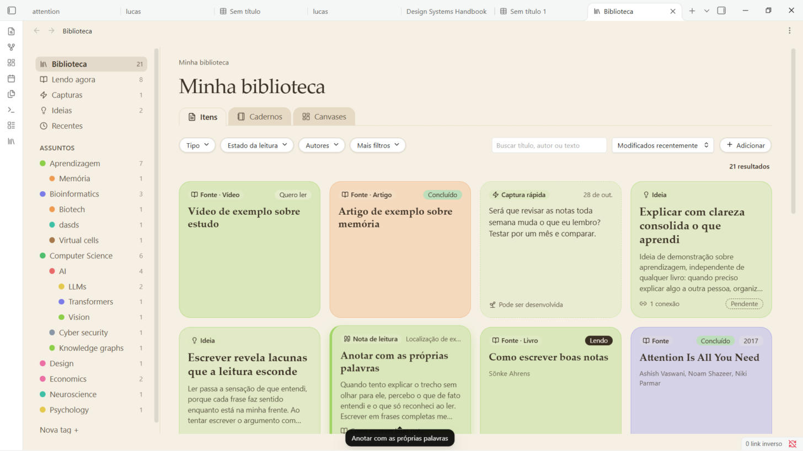
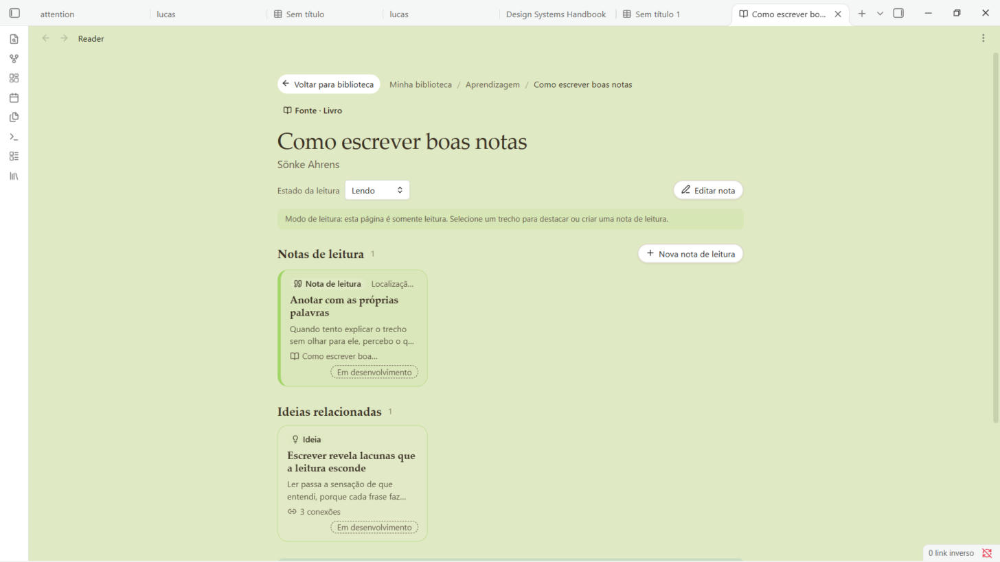
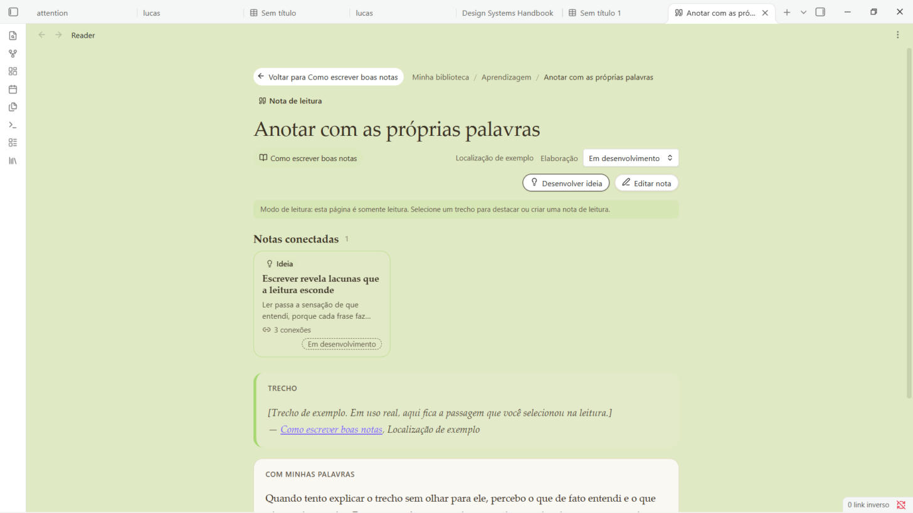

# Felisidian

A visual library for your Obsidian vault: follow what you are reading and what you are thinking from it, as pastel cards grouped by subject.

> **Status:** early development (0.1.0). See the roadmap in [docs/REQUIREMENTS.md](docs/REQUIREMENTS.md).

## Features

A library to follow what you are **reading** and what you are **thinking** from it.

- **Content types**, each with its own card: sources (book, article, video…), reading notes, ideas and quick captures.
- **Views** in the sidebar (Library, Reading now, Captures, Ideas, Recent) and a tree of subjects with colors and counts. Views are filters over the same notes, not folders.
- **Compact filters**: Type, Reading status, Authors and More filters (subject, format, linked source, elaboration, connections). Combine them freely; active filters show as removable chips with the result count.
- **Reading page** for every note, with a Back button that restores filters and scroll. Select a passage to highlight it or turn it into a **reading note** that keeps its source and location; passage and your own words are drawn as separate blocks.
- **Develop idea** opens a window with the origin note and a simple way to link other notes. Nothing is written for you.
- Pastel cards and notes tinted by subject color, drag to reorder cards, animated filtering, Portuguese and English, light and dark themes.

See [docs/PROPERTIES.md](docs/PROPERTIES.md) for the properties each type uses.





## Not yet

- Covers and metadata lookup (ISBN, DOI) and PDF/EPUB reading: out of scope for now.
- A Bases view and several highlight colors.
- Validation on mobile.

## Development

```bash
npm install
npm run dev     # watch mode, writes main.js
npm run build   # type-check + production build
```

To try it in Obsidian, copy or symlink `main.js`, `manifest.json` and `styles.css` into `<vault>/.obsidian/plugins/felisidian/`, then enable the plugin under *Settings > Community plugins*.

## Releasing

```bash
npm version patch   # bumps package.json, manifest.json and versions.json
git push --follow-tags
```

The tag (without a `v` prefix) triggers the release workflow, which builds and attaches `main.js`, `manifest.json` and `styles.css` to a GitHub release.

## Privacy

Felisidian runs entirely locally. It makes no network requests and collects no data.

## License

[MIT](LICENSE)
